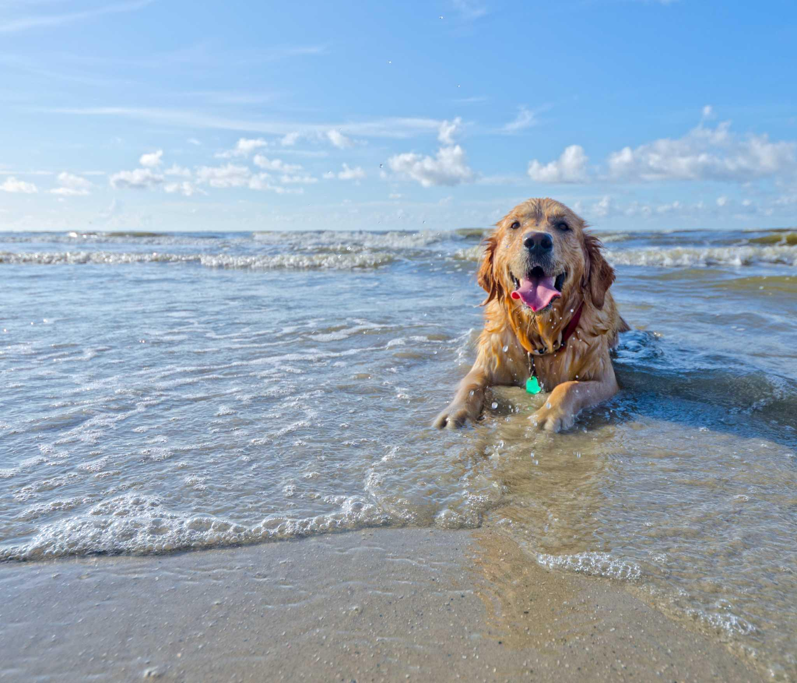
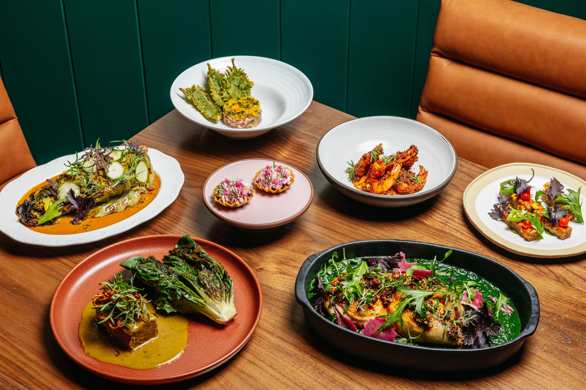

# Lab 1.2 — The thesis project as an end-to-end solution

**Deadline:** September 30

**Tasks**
1. Give examples of (X, y) in the context of the thesis and describe them in `/data/`.
2. Understand and explain how the two Colab notebooks given in the course work (video processing and image description).
3. Create a preliminary process model that shows the use of AI in the thesis.
4. Hand-draw the diagram.

---

## 1. Thesis in one sentence

> An end-to-end ETL framework that converts three heterogeneous clinical sources (Kaggle EHR, Synthea, and a Lithuanian
> kidney-biopsy registry) into the OMOP Common Data Model v5.4 on Microsoft SQL Server. The framework uses AI to map raw
> source values to standard OHDSI concepts and to support downstream patient-level prediction.

## 2. Examples of (X, y)

The relationship X → y appears on three layers of the thesis. The examples are in
[`data/examples.json`](../data/examples.json) and are described in [`data/README.md`](../data/README.md).

### Layer 1 — ETL concept mapping (the main AI task)

| X (raw source value) | y (standard OMOP concept) |
|---|---|
| omop_1 `Gender = "Male"` | `PERSON.gender_concept_id = 8507` (MALE) |
| omop_3 `lytis = "Moteris"` | `PERSON.gender_concept_id = 8532` (FEMALE) |
| omop_1 `Medical Condition = "Hypertension"` | `condition_concept_id = 316866` (Hypertensive disorder, SNOMED) |
| omop_3 `diagnoze = "Lėtinė inkstų liga"` | `condition_concept_id = 46271022` (Chronic kidney disease) |
| omop_1 `Medication = "Lipitor"` | `drug_concept_id = 1545958` (atorvastatin, RxNorm) |
| omop_3 `tyrimas = "Kreatininas"` | `measurement_concept_id = 3016723` (Creatinine, LOINC) |
| omop_1 `Admission Type = "Emergency"` | `visit_concept_id = 262` (Emergency Room and Inpatient Visit) |

### Layer 2 — Data-quality fallback

| X | y |
|---|---|
| `Gender = "Unknown"` | `gender_concept_id = 0`, `gender_source_value = "Unknown"` |
| omop_3 `lytis = "44562"` (Excel turned a value into a date serial) | `gender_concept_id = 0`, raw value kept |
| omop_3 `diagnoze = "LT-REG-7781"` (local code without ATHENA mapping) | `condition_concept_id = 0`, raw value kept |

### Layer 3 — Patient-level prediction

| X (feature vector from OMOP tables) | y |
|---|---|
| male, born 1978, 1 inpatient / 4 outpatient / 1 ER visits, 3 conditions, 5 drugs, creatinine 1.12 | 0 (no complication) |
| female, born 1965, 2 / 6 / 2 visits, 7 conditions, 9 drugs, creatinine 1.86 | 1 (complication / readmission) |

## 3. Explanation of the two course Colab notebooks

The two notebooks form **one end-to-end multimodal pipeline**. Notebook 1 turns raw videos into separate
data modalities. Notebook 2 takes one of those modalities (images) and uses an LLM to generate text from it.
Google Drive (`MyDrive/colab-output-tmp`) connects the two notebooks.

```
 Kaggle videos (.mp4)
      │  Notebook 1 – Video Data Processing Pipeline (no LLM; classic tools + Whisper)
      ├──► audio (.mp3)   ──Whisper──► transcript (.txt) ──► text-data.zip ──┐
      └──► middle frame (.jpg) ───────────────────────────► frame-data.zip ──┤  Google Drive
                                                                              │  colab-output-tmp/
      ┌───────────────────────────────────────────────────────────────────────┘
      │  Notebook 2 – Image Description Generation Pipeline (LLM)
      └──► unzip frames ──► Gemma 3 27B (Gemini API) "describe this image" ──► .txt ──► image-descriptions.zip
```

### Notebook 1: Video Data Processing Pipeline

Link: https://colab.research.google.com/drive/1P1oWHEfyRYKXRvroefokW6-71tSHC4Ng

- **Goal:** extract several data modalities from video files and save them for later AI processing.
- **Input (X):** video files (`.mp4`) from the Kaggle dataset `csanskriti/video-and-audio-samples`.
- **Output (y):** for each video: an audio file (`.mp3`), a speech transcript (`.txt`), and the middle frame (`.jpg`).
  The transcripts and frames are zipped (`text-data.zip`, `frame-data.zip`) into Google Drive.
- **Steps:**
  1. **Download the dataset:** `kagglehub.dataset_download(...)` downloads and extracts the dataset into the kagglehub cache.
     `shutil.copytree` copies it to `/content/video-data`.
  2. **Extract audio:** for each `.mp4`, `moviepy.editor.VideoFileClip(video).audio.write_audiofile(...)` writes an `.mp3`
     to `/content/audio-data/`. `video.close()` frees the file handle.
  3. **Install Whisper:** `pip install openai-whisper` (OpenAI's open-source speech-recognition model).
  4. **Transcribe:** `whisper.load_model("medium")` loads a 1.42 GB model. `model.transcribe(audio_path)` returns a
     dict, and `result["text"]` is saved as a `.txt` file in `/content/text-data/`.
     This is the **AI step** of notebook 1 (speech-to-text).
  5. **Extract the middle frame:** `video.get_frame(video.duration / 2)` returns a NumPy RGB array.
     `PIL.Image.fromarray(...).save(...)` stores it as `.jpg` in `/content/frame-data/`.
  6. **Save to Drive:** `drive.mount('/content/drive')` mounts Google Drive. A helper function `zip_folder` uses `zipfile`
     with a relative `arcname`, so the zip has no absolute paths. It writes `text-data.zip` and `frame-data.zip` to
     `MyDrive/colab-output-tmp`.
- **Observations (from the saved outputs in the notebook):**
  - The run printed `✅ 5 middle frames saved in /content/frame-data/`.
  - Whisper printed `FP16 is not supported on CPU; using FP32 instead`. This means the notebook ran on a CPU runtime.
    With **Runtime → Change runtime type → T4 GPU**, transcription is much faster.
  - `moviepy.editor` exists only in moviepy 1.x. In moviepy 2.x the import is `from moviepy import VideoFileClip`.
  - `#@title` comments turn the cells into collapsible form cells with readable titles.
- **Key concepts:** multimodal data extraction, a pretrained speech-to-text model (Whisper), intermediate storage in Drive,
  and splitting the pipeline into reusable stages.

Example frames from my run (`colab-output-tmp`):

| | |
|---|---|
|  |  |
|  |  |

### Notebook 2: Image Description Generation Pipeline

Link: https://colab.research.google.com/drive/15r2XMoSW-xx3WPewuuZK3zUkfzGJBMF4

- **Goal:** generate a natural-language description for every frame produced by notebook 1, using an LLM.
- **Input (X):** one image (`.jpg`) from `frame-data.zip`.
- **Output (y):** one text description per image (`.txt`), zipped into `image-descriptions.zip` in Google Drive.
- **Steps:**
  1. **Setup:** installs the `google-genai` SDK. It reads the API key from **Colab Secrets** with
     `userdata.get("GOOGLE_API_KEY")` and puts it in the environment variable `GEMINI_API_KEY`.
     `genai.Client()` then finds the key automatically, so the key never appears in the code.
     It also mounts Google Drive.
  2. **Extract frames:** unzips `MyDrive/colab-output-tmp/frame-data.zip` into `/content/frame-data/`.
  3. **Generate descriptions (AI step):**
     - Model: `gemma-3-27b-it`, an open-weight Gemma 3 model (27B parameters, instruction-tuned) served through the
       Gemini API. A comment shows that `gemini-1.5-flash` can be used instead.
     - For each image, a multimodal message is built: `types.Content(role="user", parts=[Part.from_text("Please describe
       what is in this image."), Part.from_bytes(image_bytes, mime_type="image/jpeg")])`.
     - `client.models.generate_content_stream(...)` returns the answer in chunks. The chunks are joined into one string.
     - A `try/except` skips an image if the API fails (for example, a quota error), so one failure does not stop the loop.
     - Each description is saved as `<frame name>.txt` in `/content/image-descriptions/`.
  4. **Archive:** zips the descriptions and saves `image-descriptions.zip` to the same Drive folder.
- **Observations (from the saved outputs in the notebook):**
  - The run printed `✅ 5 image descriptions saved in /content/image-descriptions/`.
  - The prompt is **zero-shot**: one fixed instruction and no examples. The output format is free text.
  - `mime_type` is always `image/jpeg`, even for `.png` files. A `.png` input needs `image/png`.
  - The secret here is called `GOOGLE_API_KEY`. Our lab notebooks use `GEMINI_KEY`, as the Lab 1.5 assignment requires.
- **Key concepts:** multimodal prompting (text + image), the Google Gen AI SDK, secure keys with Colab Secrets,
  streaming responses, and batch processing with error handling.

### What I take from the two notebooks for my thesis

| Course notebooks | My thesis system (OMOP-MapAgent) |
|---|---|
| Stage-based pipeline: extract → transform → AI → save | Stage-based pipeline: staging → data understanding → AI mapping → validation → OMOP load |
| Classic tools first (moviepy, PIL), AI only where needed (Whisper, Gemma) | Rules first (domain routing, cleaning, fallback), LLM only for language understanding |
| Every item becomes an (X, y) pair: video → (audio, text, frame); frame → description | Every source value becomes an (X, y) pair: raw value → standard `concept_id` |
| API key in Colab Secrets, `google-genai` client | Same: `userdata.get('GEMINI_KEY')`, `genai.Client(api_key=...)` |
| Zero-shot prompt, free-text output | Improved: system prompt with stages, strict JSON output, few-shot and RAG examples (Labs 1.4–1.6) |
| `try/except` around the API call | Retry with back-off + validator + fallback `concept_id = 0` |
| Intermediate results in Drive as zip files | Intermediate results in SQL staging tables and the `code_to_standard` mapping table |

## 4. Preliminary process model — AI in the thesis

```
 Raw sources (omop_1 Kaggle EHR, omop_2 Synthea, omop_3 LT kidney registry)
        │
        ▼
 [1] Data understanding ─ WhiteRabbit profiling, staging tables in MS SQL Server
        │
        ▼
 [2] AI CONCEPT MAPPING (LLM agent)            X = raw source value
        │                                      y = standard concept_id
        ▼
 [3] Data-quality fallback ─ unmapped → concept_id 0, raw text kept in *_source_value
        │
        ▼
 [4] ETL load (T-SQL) ─ OMOP CDM v5.4 (omop_1, omop_2, omop_3)
        │
        ▼
 [5] OHDSI Data Quality Dashboard ──(feedback: fix mappings)──► back to [2]
        │
        ▼
 [6] AI / ML PATIENT-LEVEL PREDICTION (HADES PLP)   X = patient features
        │                                           y = outcome 0/1
        ▼
 Results for researchers and clinicians
```

**AI components:** step 2 (LLM-based concept mapping, developed in Labs 1.4–1.6) and step 6 (machine-learning prediction).
All other steps are deterministic rules or standard OHDSI tools.

Digital version (source: [`diagrams/00_process_model.puml`](../diagrams/00_process_model.puml)):


## 5. Hand-drawn diagram

> **TODO (student):** draw the process model above on paper. Use boxes for the steps, arrows for the data flow,
> X at the start, y at the end, and mark the two AI boxes with a colour or the word "AI".
> Photograph or scan it and save it as `diagrams/process_model_handdrawn.jpg`.


